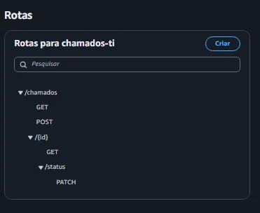
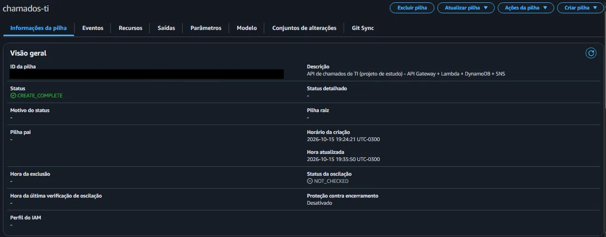
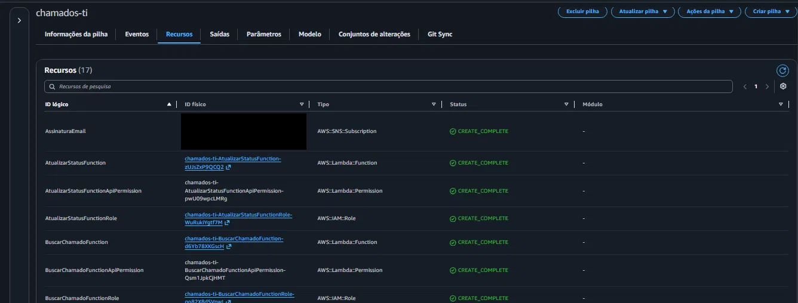
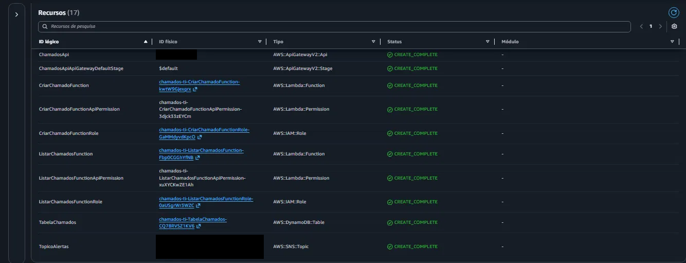
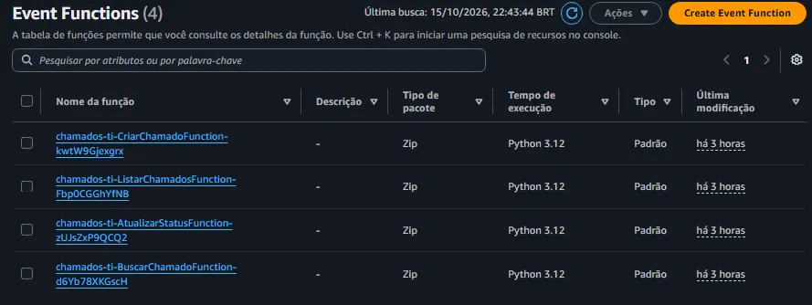
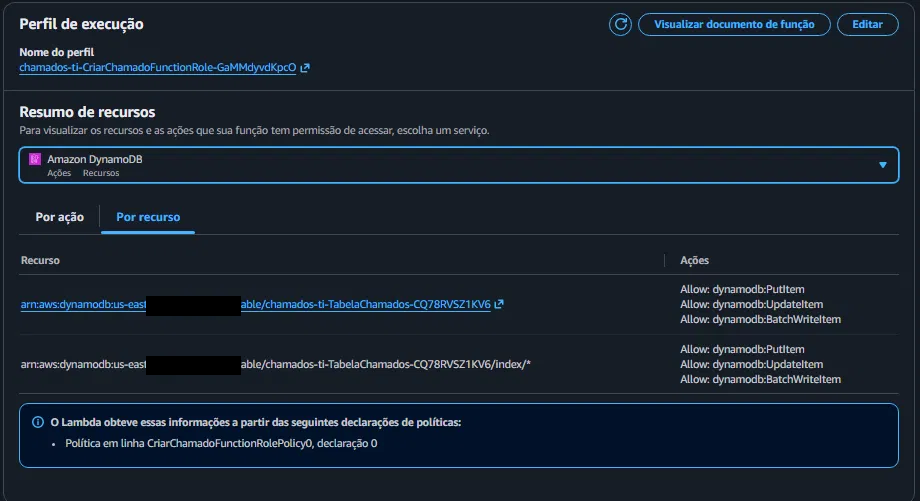
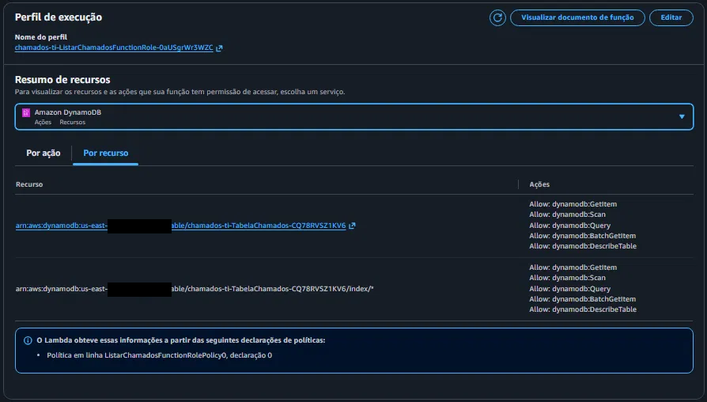
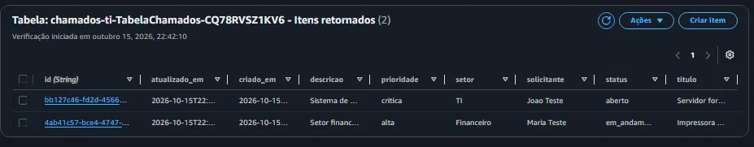
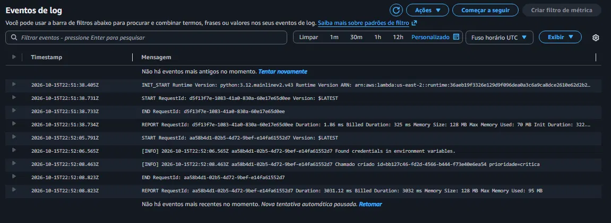
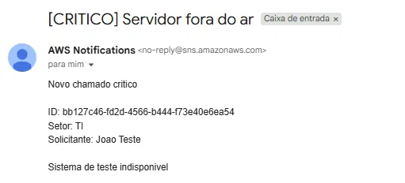

# Chamados de TI na AWS

Projeto de estudo para praticar os serviços básicos da AWS. É uma API para abrir e acompanhar chamados de suporte de TI, feita com API Gateway, Lambda, DynamoDB e SNS, e descrita toda em um template do AWS SAM. Os dados são fictícios.

Fiz o deploy em uma conta AWS real (`us-east-2`), testei as rotas, conferi os logs e depois apaguei tudo. Os prints estão mais abaixo.

## Sobre este projeto

Fiz este projeto para aprender AWS na prática. Usei IA como apoio para montar a base do código e a documentação, e fui estudando cada parte enquanto fazia o deploy, os testes na AWS e a limpeza dos recursos. Ainda estou aprendendo, então sugestões e correções são bem-vindas.

## Como funciona

```
 Cliente (curl / Postman)
          |
          v
 API Gateway (HTTP API, com limite de requisições)
          |
   +------+-------------+----------------+------------------+
   v                    v                v                  v
 criar_chamado   listar_chamados   buscar_chamado   atualizar_status      (4 funções Lambda, Python 3.12)
   |   \                 \               |                 |
   |    \_ SNS (e-mail   +---------------+-----------------+
   |       se CRÍTICO)                   v
   +------------------------------> DynamoDB (tabela "chamados")

 Logs de todas as funções -> CloudWatch (automático)
 Permissões -> IAM (uma role por função, só com o necessário)
 Tudo descrito em template.yaml (AWS SAM) -> sobe e apaga com um comando
```

Quando um chamado é aberto com prioridade `critica`, a função publica uma mensagem em um tópico SNS e o aviso chega por e-mail. Se o SNS falhar, o chamado é salvo do mesmo jeito.

## Rotas

| Método | Rota                    | O que faz                                           |
|--------|-------------------------|-----------------------------------------------------|
| POST   | `/chamados`             | Abre um chamado                                     |
| GET    | `/chamados`             | Lista (filtros opcionais `?status=` e `?prioridade=`) |
| GET    | `/chamados/{id}`        | Detalhe de um chamado                               |
| PATCH  | `/chamados/{id}/status` | Muda o status                                       |

Prioridades: `baixa`, `media` (padrão), `alta`, `critica`.
Status: `aberto` (inicial), `em_andamento`, `resolvido`, `fechado`.

Exemplos (troque `$API` pela URL que aparece no fim do deploy):

```bash
curl -X POST "$API/chamados" -H "Content-Type: application/json" -d '{
  "titulo": "Impressora sem toner",
  "descricao": "Setor financeiro sem impressão",
  "setor": "Financeiro",
  "solicitante": "Maria Teste",
  "prioridade": "alta"
}'

curl "$API/chamados?status=aberto&prioridade=alta"
curl "$API/chamados/<id>"
curl -X PATCH "$API/chamados/<id>/status" -H "Content-Type: application/json" -d '{"status":"em_andamento"}'
```

No PowerShell as aspas do `curl` dão problema, então usei o `Invoke-RestMethod`:

```powershell
$API = "https://SEU-ID.execute-api.REGIAO.amazonaws.com"
$corpo = @{ titulo="Impressora sem toner"; descricao="Setor financeiro sem impressao"; setor="Financeiro"; solicitante="Maria Teste"; prioridade="alta" } | ConvertTo-Json
$chamado = Invoke-RestMethod -Method Post -Uri "$API/chamados" -ContentType "application/json" -Body $corpo
Invoke-RestMethod "$API/chamados/$($chamado.id)"
Invoke-RestMethod -Method Patch -Uri "$API/chamados/$($chamado.id)/status" -ContentType "application/json" -Body (@{status="em_andamento"} | ConvertTo-Json)
```

Nos exemplos de PowerShell usei texto sem acento para não ter problema de codificação.

## Rodando os testes (sem AWS)

Os testes usam o `moto`, que simula DynamoDB, SNS e SQS em memória. Nada é criado na AWS.

```bash
python -m venv .venv && source .venv/bin/activate     # Windows: py -3.12 -m venv .venv e depois .venv\Scripts\activate
pip install -r requirements-dev.txt
python -m pytest -q
```

São 16 testes. Eles cobrem a validação, os filtros, os erros 400 e 404, o alerta por SNS e o caso em que o SNS falha.

## Deploy

Precisa de uma conta AWS, do AWS CLI v2, do AWS SAM CLI e do Python 3.12 (ou do Docker, usando `sam build --use-container`).

1. Criei a conta no plano Free e, antes de qualquer outra coisa, um alerta de orçamento de US$ 5.
2. Não usei a conta raiz no terminal. Criei um usuário IAM só para isso e configurei com `aws configure`. Dei a ele `AdministratorAccess`, que é prático para estudo, mas amplo demais para um projeto de verdade.
3. Compilei e fiz o deploy:
```bash
   sam build
   sam deploy --guided
```
   Nome da stack `chamados-ti`, região `us-east-2`, `EmailAlertas` com o meu e-mail, aceitei a criação das roles e salvei a configuração em `samconfig.toml`. O SAM avisa que as rotas não têm autenticação, e para este estudo respondi `y`.
4. No fim o terminal mostra o `ApiUrl`. Confirmei a assinatura do SNS no e-mail que chegou.
5. Testei as quatro rotas e abri um chamado `critica` para receber o alerta.
6. Olhei os logs com `sam logs -n CriarChamadoFunction --stack-name chamados-ti --tail` e também pelo console.
7. Apaguei tudo:
```bash
   sam delete --stack-name chamados-ti
```
   O `sam delete` não remove os grupos de log do CloudWatch, porque o Lambda os cria fora da stack. Apaguei na mão os grupos `/aws/lambda/chamados-ti-*`. A stack `aws-sam-cli-managed-default`, que o próprio SAM cria para guardar o código enviado, deixei lá. O custo dela é desprezível.

## O que deu errado no caminho

- **Python:** eu tinha o 3.10 e o Lambda usa 3.12. Instalei o 3.12 e criei o ambiente virtual com `py -3.12 -m venv .venv`.
- **E-mail:** no `sam deploy --guided` digitei `y` no campo do e-mail sem querer. Percebi no resumo das mudanças (`Parameter overrides`), cancelei antes de confirmar e refiz.
- **Região:** usei `us-east-2` em tudo. Quando um recurso não aparece no console, a primeira coisa que confiro é a região na URL.
- **Logs:** o `sam delete` não apagou os grupos de log, como contei acima.
- **Latência:** nos logs, a execução que publicou no SNS levou cerca de 3 segundos, bem mais que as outras. Ainda não investiguei o motivo.

## Evidências do deploy

Prints do deploy real em `us-east-2`, com os identificadores da conta omitidos.

**Rotas no API Gateway**



**Stack no CloudFormation e seus 17 recursos**





**As 4 funções Lambda (Python 3.12)**



**Permissões: criar só escreve, listar só lê**




**Chamados gravados no DynamoDB**



**Logs no CloudWatch**



**Alerta por e-mail de um chamado crítico**



## Decisões

- **Lambda:** não tem servidor para cuidar e o custo é por uso. Combina com um sistema de chamados, que tem tráfego irregular.
- **DynamoDB:** o acesso principal é por `id` e não há joins. Em troca, consulta flexível é mais difícil. A listagem usa `Scan` com filtro, o que serve para poucos itens.
- **Uma função por rota, cada uma com a sua permissão:** quem lê não consegue escrever no banco.
- **SAM:** o ambiente fica reproduzível, versionado no Git e some com um comando.
- **Só `boto3`:** ele já vem no ambiente do Lambda, então não tem pacote para empacotar. A validação é manual e simples.
- **Falha no SNS não derruba o chamado:** o alerta é secundário, o importante é salvar.
- **Limite de requisições no API Gateway:** a URL é pública, então limitei a taxa para reduzir abuso.

## Limitações e próximos passos

- Sem autenticação: quem tiver a URL acessa a API. Por isso a stack ficou no ar só durante os testes. Em produção eu usaria um authorizer JWT, por exemplo com Cognito.
- O `Scan` não escala. Em escala eu criaria um índice secundário (GSI) por `status`. Também falta paginação na resposta da API.
- Sem pipeline de deploy automático (GitHub Actions seria o próximo passo).
- Sem alarmes no CloudWatch (um alarme de erros nas funções seria o próximo).
- Sem frontend.
- Os testes automatizados usam serviços simulados. A verificação contra a AWS real foi manual.

## Estrutura

```
template.yaml            # infraestrutura (SAM/CloudFormation)
src/common.py            # validação, resposta HTTP, acesso ao DynamoDB, alerta SNS
src/criar_chamado.py     # POST   /chamados
src/listar_chamados.py   # GET    /chamados
src/buscar_chamado.py    # GET    /chamados/{id}
src/atualizar_status.py  # PATCH  /chamados/{id}/status
tests/                   # testes com moto
docs/                    # prints do deploy
LICENSE                  # MIT
```

## Licença

MIT (veja o arquivo `LICENSE`).